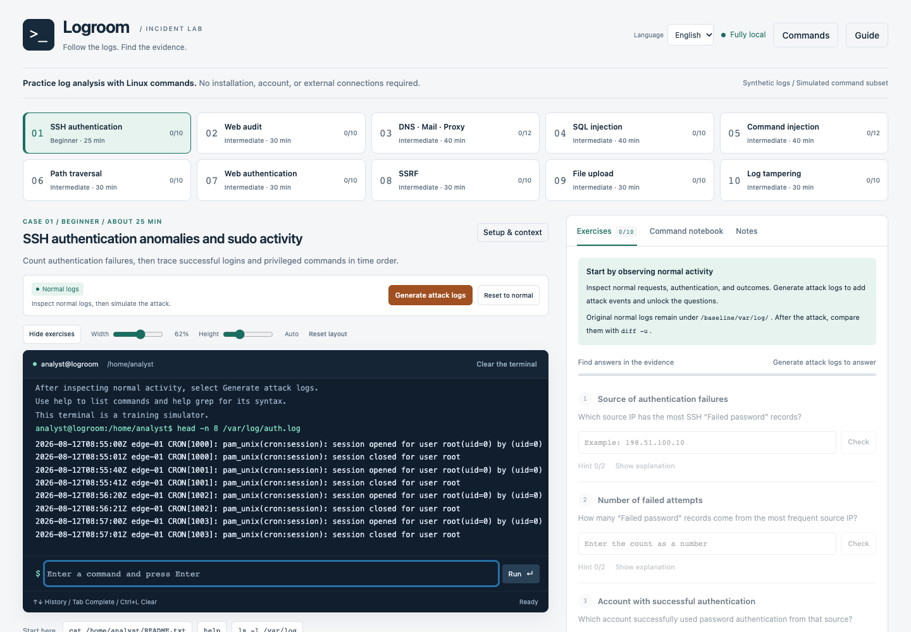

<p align="center">
  
</p>

# Logroom

[日本語](README.md) · **English** · [ภาษาไทย](README.th.md)


**Read the logs. Follow the evidence.**

[Play Now](https://retiacole.github.io/logroom/) · [Download one HTML file](https://github.com/retiacole/logroom/releases/latest/download/logroom.html)

**Practice log analysis with Linux-style commands, entirely in your browser.**

Search, count, and correlate synthetic authentication, Web, application, DNS, proxy, and mail logs. Inspect normal activity, apply a prepared attack scenario with a button, and answer questions using the evidence you find. Logroom runs from one HTML file without installation, a backend, or a Linux environment.

<br clear="right">

This app and its documentation were created with OpenAI Codex (AI). The project maintainers are responsible for reviewing, correcting, and maintaining the content.



## Start learning

1. Download the single-file [logroom.html](https://github.com/retiacole/logroom/releases/latest/download/logroom.html).
2. Open the downloaded file in a browser with JavaScript enabled.
3. Use the **Language** selector to choose Japanese, English, or Thai.
4. Choose a case and open **Setup & context**. Inspect the normal logs, select **Generate attack logs**, and investigate in the terminal.

You can also download [index.html](index.html) from GitHub using **Download raw file**. Both files contain the same standalone app; no additional files are needed.

```sh
cat /home/analyst/README.txt
ls -l /var/log
help grep
```

The exercises work offline. If organizational settings block local HTML files, the same file can be hosted on an approved website. Opening external references requires network access.

## What you can practice

- **10 original cases / 104 questions, plus 4 entry questions and 2 exit checks**, including SSH authentication, SQL injection, command injection, path traversal, SSRF, uploads, and log tampering.
- **Practice mode** adds sudo, rotated logs, over 20,000 SSH log lines, seeded IP variants, a timeline file exercise and tar exports with real gzip history. Progress is stored per mode and seed.
- **61 commands**, with common options, pipes, virtual-file output, JSON extraction, and basic `vi` editing. Use **Commands** or `help command` to check the supported syntax.
- Context and server-topology descriptions, progressive hints, supporting log lines, and investigation walkthroughs.
- Detailed debriefs after every question in a case is correct: technical knowledge, observed attack stages, mitigations, related historical incidents, and primary-source links.
- Resizable terminal, a collapsible exercise panel, notes, and note export.

The language selector translates the interface, all questions, hints, context descriptions, and debriefs. Command names and syntax, log evidence, and expected answers stay the same. Your own notes and files are not translated. External source documents remain in their original languages.

## Simulator scope and progress

Logroom is a **log-analysis simulator**, not an operating system. No real servers, attacks, SQL, OS commands, or network connections run. The terminal operates on virtual files; the logs, addresses, and accounts are fictional. Commands implement a learning subset, and unsupported syntax returns an error. The SSH case uses traditional syslog (year and timezone supplied by the exercise context); the Web case combines nginx JST timestamps with UTC application logs. Check each case README.

Progress, answers, notes, history, and virtual-file edits are saved in the browser’s **localStorage**, not cookies. The same progress is shared across all three interface languages in the same browser and origin. Changing browser, website, or local HTML location does not automatically transfer progress. Private browsing, storage restrictions, or clearing browser data can remove it. Export important notes; note export is not a restorable full-progress backup.

**Reset to normal** clears the selected case’s answers, notes, history, and virtual-file changes. Other cases are preserved. The virtual `rm -rf --no-preserve-root /` command also resets the selected case after a GAME OVER animation. `sl` displays a short train animation that cannot be stopped with Ctrl+C.

## Documentation and development

The detailed [user guide](docs/USER_GUIDE.md), [command reference](docs/COMMANDS.md), [case list](docs/EXERCISES.md), [development guide](docs/DEVELOPMENT.md), and [publishing guide](docs/PUBLISHING.md) are currently in Japanese. The in-app learning content is available in all three languages. [External references](docs/REFERENCES.md) link to original public documentation.

Node.js 22 or newer is needed only for development, not for using the exercise:

```sh
node scripts/build.js
npm test
```

The build bundles `src/` into the standalone `index.html`, `dist/index.html`, and `dist/logroom.html`. After setting up the browser-test dependencies described in the development guide, you can also run `npm run test:browser`.

## License

[MIT License](LICENSE). Preserve the copyright and license notices when using, modifying, or redistributing the project. External reference documents belong to their respective rights holders and are not covered by this license.

<p align="center">
  
</p>

## Entry practice and graduation checks

Case 0 uses six log lines to practice selecting records, extracting variable fields, counting and saving original evidence. Experienced learners can select any original case directly. General foundations are available before answering every case.

The Web and DNS/proxy/mail cases include exit checks: select source-linked evidence and distinguish findings, unknowns and next checks. Short handoff notes are for self-comparison with examples; their meaning is not automatically graded. Original completion records remain valid. Completing the ten original cases and both exit checks shows an optional recommendation for pcaproom-easy. Continue reviewing or using practice mode in this room whenever you prefer. No automatic navigation or cross-room progress sharing occurs.

The version at the top of the page comes from package.json and is identical in all three languages and offline HTML files.

Each original case also has one optional concept check. Its response is saved separately and does not change original question counts or completion rules. The learning guide explains operation review, core investigation, attack-specific application and practice mode; the order remains your choice.
