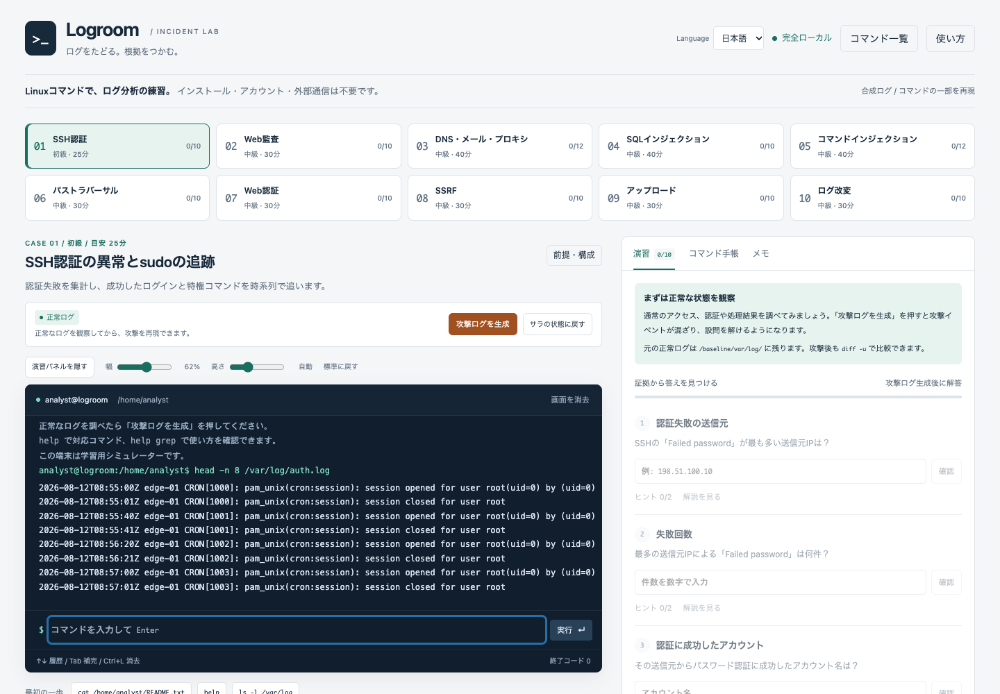

<p align="center">
  
</p>

# Logroom

[日本語](README.md) · [English](README.en.md) · [ไทย](README.th.md)


**ログを読み、証拠をつなぐ。**<br>
*Read the logs. Follow the evidence.*

[ブラウザで使う](https://retiacole.github.io/logroom/) · [HTML 1個をダウンロード](https://github.com/retiacole/logroom/releases/latest/download/logroom.html)

**インストール不要。ブラウザだけで、Linuxコマンドによるログ分析を練習する教材です。**

認証ログ、Webアクセスログ、アプリ監査、DNS・プロキシ・メールのログを、検索・集計・照合して調査します。正常な状態を観察し、ボタンで攻撃イベントを反映し、証拠から設問に答えていきます。

単独のHTMLファイルで動作します。管理者権限やLinux環境を用意できないWindows端末での自習、授業、社内研修を想定しています。

<br clear="right">

このアプリとドキュメントは、OpenAI Codex（AI）を使って作成しました。内容の確認・修正・更新は、プロジェクトのメンテナーが行います。



Browser-only log analysis practice with a Linux-like command line. No installation or backend required.

## はじめる

1. [オフライン用の logroom.html](https://github.com/retiacole/logroom/releases/latest/download/logroom.html) をダウンロードして、JavaScriptを実行できるブラウザで開きます。HTMLは1個だけで動作します。
2. ケースを選び、**前提・構成**で状況と調査対象を確認します。
3. 正常ログを読んだあと、**攻撃ログを生成**を押します。
4. ターミナルで調査し、右側の演習に解答します。

リポジトリの [index.html](index.html) を「Download raw file」で保存して使うこともできます。どちらも同じアプリを単独のHTMLで利用できます。

```sh
cat /home/analyst/README.txt
ls -l /var/log
help grep
```

ローカルHTMLの実行が組織の設定で禁止されている場合は、管理者が許可したWebサイトに同じファイルを配置して利用できます。演習本体にインターネット接続は不要です。解説中の外部資料を開く場合は通信が必要です。

## できること

- **10ケース・104問**。SSH認証、Web調査、SQLインジェクション、コマンドインジェクション、SSRF、ログ改変などを扱います。
- **実践モード**：sudo・ローテーション済みログ・2万行規模のSSHログ、シードによるIP変更、調査ファイルの提出、実機へ持ち出すtar出力。
- **61コマンド**。`grep`、`awk`、`sed`、`sort`、`uniq`、`jq`などの主要な操作、パイプ、仮想ファイルへの出力を練習できます。
- 画面の**コマンド一覧**で、対応コマンドとオプションを検索できます。
- `vi`の基本操作で仮想ファイルを編集できます。
- 各ケースの状況・構成説明、段階的なヒント、根拠ログ、調査の進め方を確認できます。
- ケースの全問正解後に、技術知識、攻撃の流れ、対策、関連する歴史的な事案、公式資料へのリンクを読めます。
- ターミナルの幅・高さを調整し、演習パネルを折りたためます。
- 進捗をブラウザに自動保存し、調査メモをテキストで書き出せます。
- **日本語・English・ไทย**を画面右上で切り替えられます。設問・ヒント・構成説明・詳細解説も切り替わり、進捗やメモは3言語で共通です。調査するログ、正解の値、コマンド構文は変わりません。

## 教材の範囲

Logroomは**ログ分析のためのシミュレーター**です。Linuxそのものや実際のサーバーを起動するものではありません。

ログ、IPアドレス、ドメイン、アカウントは教材用の架空データです。「攻撃ログを生成」は用意した静的ログを反映する操作で、ネットワークへの攻撃、SQLの実行、OSコマンドの実行は発生しません。コマンドが操作するのはブラウザ内の仮想ファイルです。

コマンドは学習用の部分実装です。対応構文は `help コマンド名` で確認できます。パッケージ追加、サービス起動、実ネットワーク通信、シェルスクリプトの実行には対応していません。SSHは年・TZ表記のない従来syslog形式（演習では2026年・UTC）、WebケースのnginxはJST、アプリ監査ログはUTCです。各ケースのREADMEで前提を確認します。

## 保存について

Cookieではなく、ブラウザの **localStorage** に解答・メモ・履歴・仮想ファイルの変更などを保存します。アカウント登録やサーバーへの進捗送信はありません。

保存はブラウザと表示先に依存します。ローカルファイルからGitHub Pagesへ移動した場合や、ブラウザを変更した場合に、進捗は自動移行されません。ブラウザのデータ削除、プライベート閲覧、組織の保存制限によって失われる場合があります。大事な調査結果は**調査メモを書き出す**で残してください。これは全進捗の復元用バックアップではありません。

## ドキュメント

- [操作ガイド](docs/USER_GUIDE.md)：演習の進め方、保存、リセット、画面調整、vi
- [コマンドとオプション](docs/COMMANDS.md)：61コマンドの一覧、対応構文、利用例
- [演習一覧](docs/EXERCISES.md)：ケースの題材、設問数、調査するログ
- [参考資料](docs/REFERENCES.md)：技術資料・歴史的事案の一次資料へのリンク
- [開発ガイド](docs/DEVELOPMENT.md)・[演習の追加](docs/AUTHORING.md)：ソース構成、テスト、教材を拡張する方法
- [GitHubへの公開手順](docs/PUBLISHING.md)：リポジトリ・Pages・オフライン版の公開
- [変更履歴](CHANGELOG.md)・[セキュリティとデータの扱い](SECURITY.md)

## 小さなおまけ

仮想ターミナルで `sl` を実行すると、蒸気機関車が約5秒間通過します。Ctrl+Cでは止まりません。

同じく仮想ターミナルで `rm -rf --no-preserve-root /` を実行すると、画面崩壊と「GAME OVER」の演出のあと、**選択中のケース**が正常ログの初期状態に戻ります。そのケースの解答・メモ・履歴・作成ファイルは消えます。他ケースの進捗は保持します。

## 不具合の報告

再現するケース、入力したコマンド、期待した結果、実際の結果、ブラウザ名を添えてIssueを作成してください。実際の組織のログ、秘密情報、個人情報は含めず、教材の合成データで再現できる例があると調査しやすくなります。

## 開発する

ビルドとテストにはNode.jsを使います。演習の利用者にはNode.jsは不要です。

```sh
node scripts/build.js
npm test
```

ビルドは `src/` のHTML・CSS・JavaScriptを単独のHTMLへまとめます。公開用の `index.html` と `dist/index.html`、ダウンロード用の `dist/logroom.html` を生成します。GitHub Pagesには `dist/` を配信します。

```text
src/       画面、コマンド、vi、演習データ、解説
scripts/   ビルド用スクリプト
tests/     コマンド、演習データ、画面の検証
docs/      操作・コマンド・演習のドキュメント
dist/      配信・ダウンロード用HTML
```

ブラウザ検証用の環境を用意した場合は `npm run test:browser` も実行できます。ソースを変更したら再ビルドし、生成物とドキュメントも更新してください。

## ライセンス

[MIT License](LICENSE)。著作権表示とライセンス文を残したうえで、利用・改変・再配布できます。外部の参考資料はそれぞれの権利者に帰属し、このライセンスの対象には含みません。`sl`の図柄はLogroom用の独自の線画で、元のslプログラムは同梱していません。

<p align="center">
  
</p>
