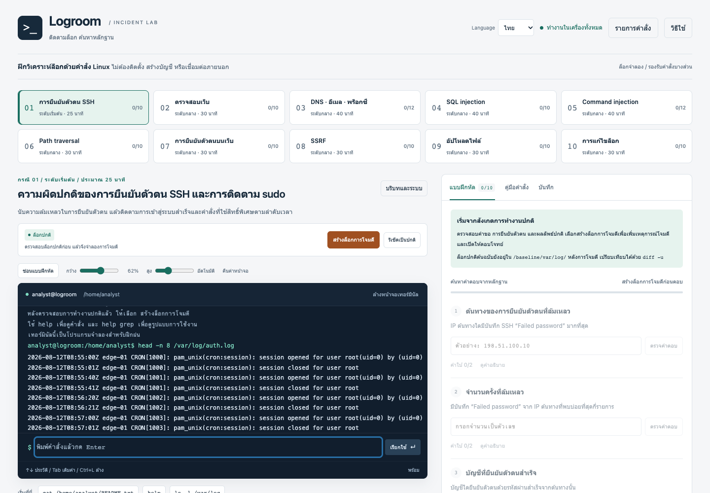

# Logroom

[日本語](README.md) · [English](README.en.md) · **ภาษาไทย**

แอปและเอกสารนี้สร้างขึ้นโดยใช้ OpenAI Codex (AI) ผู้ดูแลโครงการมีหน้าที่ตรวจสอบ แก้ไข และดูแลเนื้อหา

[เปิดใช้งานในเบราว์เซอร์](https://retiacole.github.io/logroom/) · [ดาวน์โหลด HTML ไฟล์เดียว](https://github.com/retiacole/logroom/releases/latest/download/logroom.html)

**ฝึกวิเคราะห์ล็อกด้วยคำสั่งแบบ Linux ได้ในเบราว์เซอร์ทั้งหมด**

ค้นหา นับ และเชื่อมโยงบันทึกจำลองของการยืนยันตัวตน เว็บ แอปพลิเคชัน DNS พร็อกซี และอีเมล เริ่มจากตรวจสอบกิจกรรมปกติ กดปุ่มเพื่อใช้สถานการณ์โจมตีที่เตรียมไว้ แล้วตอบคำถามจากหลักฐานที่พบ Logroom ใช้ไฟล์ HTML เพียงไฟล์เดียว ไม่ต้องติดตั้งโปรแกรม ไม่ต้องมีเซิร์ฟเวอร์เบื้องหลัง และไม่ต้องเตรียมระบบ Linux



## เริ่มใช้งาน

1. ดาวน์โหลด [logroom.html](https://github.com/retiacole/logroom/releases/latest/download/logroom.html) ซึ่งเป็นแอปแบบ HTML ไฟล์เดียว
2. เปิดไฟล์ที่ดาวน์โหลดในเบราว์เซอร์ที่อนุญาต JavaScript
3. ใช้ตัวเลือก **ภาษา** เพื่อเลือกภาษาญี่ปุ่น อังกฤษ หรือไทย
4. เลือกกรณี เปิด **บริบทและระบบ** เพื่อตรวจสถานการณ์ อ่านล็อกปกติ แล้วกด **สร้างล็อกการโจมตี** และตรวจสอบด้วยเทอร์มินัล

หรือดาวน์โหลด [index.html](index.html) จากหน้าดูไฟล์ของ GitHub โดยใช้ **Download raw file** ไฟล์ทั้งสองเป็นแอปแบบไฟล์เดียวที่ใช้งานได้เหมือนกัน ไม่ต้องมีไฟล์เพิ่มเติม

```sh
cat /home/analyst/README.txt
ls -l /var/log
help grep
```

แบบฝึกหัดทำงานออฟไลน์ได้ หากนโยบายองค์กรห้ามเปิด HTML ในเครื่อง สามารถนำไฟล์เดียวกันไปไว้บนเว็บไซต์ที่ได้รับอนุญาต การเปิดเอกสารอ้างอิงภายนอกต้องใช้เครือข่าย

## สิ่งที่ฝึกได้

- **10 กรณี รวม 104 คำถาม** ครอบคลุมการยืนยันตัวตน SSH, SQL injection, command injection, path traversal, SSRF, การอัปโหลด และการแก้ไขล็อก
- **52 คำสั่ง** พร้อมตัวเลือกที่ใช้บ่อย ไปป์ การเขียนผลลงไฟล์จำลอง การดึง JSON และการแก้ไขด้วย `vi` ขั้นพื้นฐาน ดูรูปแบบที่รองรับได้จาก **รายการคำสั่ง** หรือ `help command`
- คำอธิบายสถานการณ์และโครงสร้างเซิร์ฟเวอร์ คำใบ้ทีละขั้น บรรทัดล็อกที่เป็นหลักฐาน และแนวทางการสืบสวน
- เมื่อตอบถูกทุกข้อในกรณี จะเปิดคำอธิบายโดยละเอียดได้ มีความรู้ทางเทคนิค ลำดับการโจมตีที่สังเกตได้ แนวทางป้องกัน เหตุการณ์จริงในอดีต และลิงก์แหล่งข้อมูลปฐมภูมิ
- ปรับขนาดเทอร์มินัล พับแผงแบบฝึกหัด เขียนและส่งออกบันทึกการตรวจสอบได้

ตัวเลือกภาษาจะแปลส่วนติดต่อ คำถามทั้งหมด คำใบ้ บริบท และคำอธิบายสรุปบทเรียน ชื่อและรูปแบบคำสั่ง หลักฐานในล็อก และคำตอบที่ต้องกรอกยังคงเดิม บันทึกและไฟล์ที่คุณเขียนเองจะไม่ถูกแปล ส่วนเอกสารอ้างอิงภายนอกยังเป็นภาษาต้นฉบับ

## ขอบเขตของโปรแกรมจำลองและการบันทึกความคืบหน้า

Logroom เป็น **โปรแกรมจำลองสำหรับวิเคราะห์ล็อก** ไม่ใช่ระบบปฏิบัติการ ไม่มีเซิร์ฟเวอร์จริง การโจมตี การเรียก SQL คำสั่งระบบปฏิบัติการ หรือการเชื่อมต่อเครือข่ายทำงานอยู่ เทอร์มินัลจัดการเฉพาะไฟล์จำลอง บันทึก ที่อยู่ และบัญชีทั้งหมดเป็นข้อมูลสมมติ คำสั่งรองรับเฉพาะส่วนที่ใช้เรียนรู้ และจะแจ้งข้อผิดพลาดเมื่อใช้รูปแบบที่ไม่รองรับ เวลาทั้งหมดในล็อกเป็น UTC

คำตอบ บันทึก ประวัติ และการแก้ไขไฟล์จำลองจะเก็บใน **localStorage** ของเบราว์เซอร์ ไม่ใช่ Cookie ทั้งสามภาษาใช้ความคืบหน้าชุดเดียวกันเมื่อเปิดด้วยเบราว์เซอร์และ origin เดิม การเปลี่ยนเบราว์เซอร์ เว็บไซต์ หรือตำแหน่งไฟล์ HTML จะไม่ย้ายความคืบหน้าให้อัตโนมัติ โหมดส่วนตัว ข้อจำกัดการบันทึก หรือการล้างข้อมูลเบราว์เซอร์อาจทำให้ข้อมูลหาย ควรส่งออกบันทึกสำคัญไว้ โดยไฟล์บันทึกที่ส่งออกไม่ใช่สำเนาความคืบหน้าทั้งหมดสำหรับกู้คืน

**รีเซ็ตเป็นปกติ** จะล้างคำตอบ บันทึก ประวัติ และการแก้ไขไฟล์จำลองของกรณีที่เลือก โดยเก็บกรณีอื่นไว้ คำสั่งจำลอง `rm -rf /` จะรีเซ็ตกรณีที่เลือกหลังภาพเคลื่อนไหว GAME OVER เช่นกัน ส่วน `sl` แสดงรถไฟวิ่งผ่านช่วงสั้น ๆ และหยุดด้วย Ctrl+C ไม่ได้

## เอกสารและการพัฒนา

[คู่มือใช้งาน](docs/USER_GUIDE.md), [รายการคำสั่ง](docs/COMMANDS.md), [รายการกรณี](docs/EXERCISES.md), [คู่มือพัฒนา](docs/DEVELOPMENT.md) และ [วิธีเผยแพร่](docs/PUBLISHING.md) ฉบับละเอียดขณะนี้เป็นภาษาญี่ปุ่น เนื้อหาการเรียนภายในแอปมีครบทั้งสามภาษา [เอกสารอ้างอิงภายนอก](docs/REFERENCES.md) เชื่อมไปยังเอกสารสาธารณะต้นฉบับ

ต้องใช้ Node.js 22 ขึ้นไปเฉพาะตอนพัฒนา ผู้เรียนไม่ต้องติดตั้ง Node.js:

```sh
node scripts/build.js
npm test
```

การบิลด์รวม `src/` เป็นไฟล์อิสระ `index.html`, `dist/index.html` และ `dist/logroom.html` เมื่อตั้งค่าชุดทดสอบเบราว์เซอร์ตามคู่มือพัฒนาแล้ว สามารถเรียก `npm run test:browser` เพิ่มได้

## สัญญาอนุญาต

[MIT License](LICENSE) ใช้ แก้ไข และแจกจ่ายต่อได้โดยคงข้อความลิขสิทธิ์และสัญญาอนุญาตไว้ เอกสารอ้างอิงภายนอกเป็นสิทธิ์ของเจ้าของแต่ละรายและไม่อยู่ภายใต้สัญญาอนุญาตนี้
